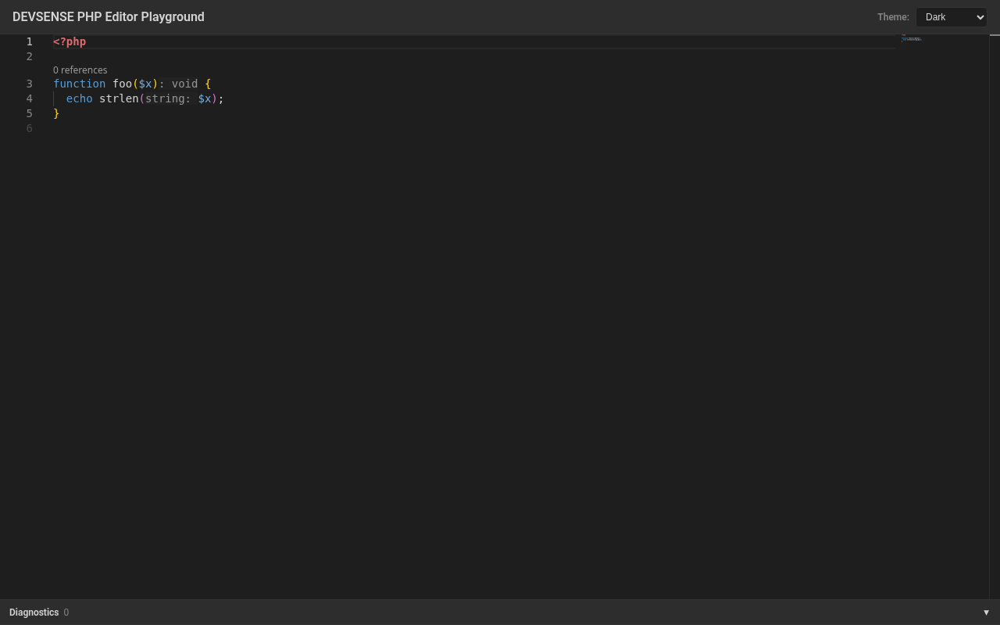
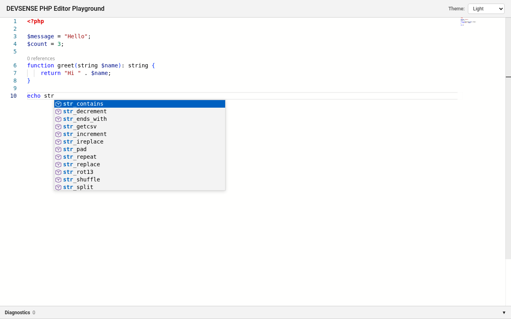
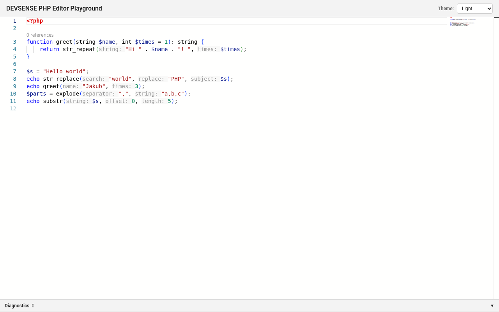
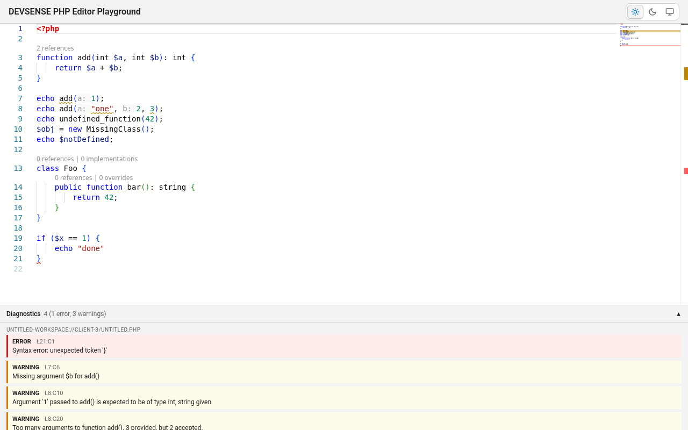

# DEVSENSE PHP Editor

An online PHP editor: [Monaco Editor](https://microsoft.github.io/monaco-editor/) in the browser, backed by the
[DEVSENSE PHP language server](https://www.npmjs.com/package/devsense-php-ls) (`devsense-php-ls`) running on a Node.js server.
The browser talks to the language server over a WebSocket using JSON-RPC (LSP messages).

This is an npm-workspaces monorepo with two packages:

| Package | What it is |
| --- | --- |
| [`packages/devsense-php-editor`](packages/devsense-php-editor) | The library. Node side: the `PhpEditor` class (spawns `devsense-php-ls`, runs the WebSocket server and routes messages). Browser side: `devsense-php-editor/browser`, the `createPhpEditor` component (Monaco editor + WebSocket LSP client + providers + diagnostics). |
| [`packages/devsense-php-editor-sampleweb`](packages/devsense-php-editor-sampleweb) | A demo page (Vite) that only uses `createPhpEditor`: page layout, theme switcher, diagnostics panel, sample code. It has no Monaco dependency and no editor code. It also contains the Playwright end-to-end tests. |

## Screenshots

| | |
| --- | --- |
|  |  |
| Overview (dark theme): inlay hint and code lens | Completion list after typing `str` |
|  |  |
| Parameter-name inlay hints in function calls | Diagnostics panel expanded, with squiggles\* |

\* This screenshot was taken before `devsense-php-ls` 1.0.19497, which publishes diagnostics for
`untitled-workspace-{id}://` documents. It used a temporary URI workaround. The diagnostics shown are real server output,
and since 1.0.19497 the editor shows them as-is.

## Architecture

```
 Browser (Monaco + devsense-php-editor/browser providers)  ×N clients
        │  WebSocket, JSON-RPC (LSP)
        ▼
 PhpEditor (Node)  ──  WsServer ── Router ── LsServer
                                              │ stdio
                                              ▼
                                   devsense-php-ls (one process)
```

- **One shared language server.** `PhpEditor.start()` spawns a single `devsense-php-ls` process and the `Router` performs the
  only real `initialize` / `initialized` handshake with it at startup. The resulting capabilities are cached.
- **Faked per-client `initialize`.** When a browser client sends `initialize`, the Router answers locally with the cached
  `InitializeResult`. A client's `initialized`, `shutdown` and `exit` are swallowed (`shutdown` gets a `null` result), so
  a client connecting, reloading or disconnecting never restarts or re-initializes the shared server.
- **`untitled-workspace-{id}://` sandboxing.** Each WebSocket connection gets its own virtual workspace
  (`VirtualWorkspace`) with the scheme `untitled-workspace-{clientId}://`. Right after connecting, the server sends the
  client a `client/workspace` notification with `{ clientId, workspaceUri }`. The client must create its documents under
  that URI (for example `untitled-workspace-client-1://untitled.php`). The Router records which client opened which document
  (`textDocument/didOpen`) and routes `textDocument/publishDiagnostics` only to the owning client. LS request ids are
  remapped per client, so concurrent clients never see each other's responses.
- `$/devsense/stats` (a request) returns `{ lsInitializeCount, clientId, clients }`. It's used by the tests to prove there is
  only one real `initialize`.

## Features

`createPhpEditor` registers these Monaco providers (also exported individually from `devsense-php-editor/browser`), each mapped to an LSP request:

| Provider | LSP method |
| --- | --- |
| `CompletionProvider` | `textDocument/completion` |
| `HoverProvider` | `textDocument/hover` |
| `SignatureHelpProvider` | `textDocument/signatureHelp` |
| `DefinitionProvider` | `textDocument/definition` |
| `ReferencesProvider` | `textDocument/references` |
| `DocumentSymbolProvider` | `textDocument/documentSymbol` |
| `CodeActionProvider` | `textDocument/codeAction` (+ `codeAction/resolve`; commands run via `workspace/executeCommand`, server edits arrive as `workspace/applyEdit`). Premium, see [Premium features & licensing](#premium-features--licensing) |
| `FormattingProvider` | Format Document, sent as `textDocument/rangeFormatting` over the whole document (the server has no `textDocument/formatting`) |
| `RangeFormattingProvider` | `textDocument/rangeFormatting` |
| `OnTypeFormattingProvider` | `textDocument/onTypeFormatting` |
| `SemanticTokensProvider` | `textDocument/semanticTokens/full` |
| `InlineCompletionProvider` | `textDocument/inlineCompletion` (premium, see [Premium features & licensing](#premium-features--licensing)) |
| `InlayHintsProvider` | `textDocument/inlayHint` |
| `CodeLensProvider` | `textDocument/codeLens` (+ `codeLens/resolve`) |
| `RenameProvider` | `textDocument/rename` |

Diagnostics come from the server as `textDocument/publishDiagnostics` notifications. `createPhpEditor` turns them into
Monaco markers and emits them through `onDiagnostics`.

## Requirements

- Node.js 18 or newer (`engines.node >= 18`).
- npm 7+ (workspaces).
- `devsense-php-ls` is an npm dependency of the library and installs with it. The sample and the tests need the
  platform binary it provides.
- For the tests: Playwright's Chromium (`npx playwright install chromium`).

## Getting started (this repo)

```bash
npm install          # installs all workspaces; the library's `prepare` script builds it
npm run dev          # builds the library, starts PhpEditor + Vite on http://localhost:5173
```

## Using the `devsense-php-editor` package

```bash
npm install devsense-php-editor
```

`monaco-editor` comes with the package (a regular dependency). See [Bundler requirements & limitations](#bundler-requirements--limitations).

The package has two entry points:

| Import | Environment | File |
| --- | --- | --- |
| `devsense-php-editor` | Node (CommonJS) | `dist/index.js`, types in `dist/types/index.d.ts` |
| `devsense-php-editor/browser` | Browser (ESM) | `dist-browser/providers.browser.js`, types in `dist/types/providers/browser-index.d.ts` |

Build outputs (`dist/`, `dist-browser/`) are not committed. `npm run build` (or `prepare` on install) produces them.

### Server side: `PhpEditor`

```ts
import { PhpEditor, type PhpEditorOptions } from 'devsense-php-editor';
```

`new PhpEditor(options?: PhpEditorOptions)`

| Option | Type | Default | Meaning |
| --- | --- | --- | --- |
| `port` | `number` | `8765` | WebSocket port. `0` picks a free port. |
| `host` | `string` | `'127.0.0.1'` | Interface the WebSocket server binds to. |
| `license` | `string` | `process.env.DEVSENSE_PHP_LS_LICENSE` | Licence key, or the whole offline-activation `{JSON CODE}` string. Sent only in the server's own `initialize` as `initializationOptions["0"]`. Never sent to browsers, never logged. See [Premium features & licensing](#premium-features--licensing). |
| `licenseKey` | `string` | – | Deprecated alias of `license`. |
| `initializationOptions` | `Record<string, unknown>` | – | Extra options merged into the language server `initialize`. A `"0"` here is overridden by `license`. |
| `cwd` | `string` | – | Working directory of the `devsense-php-ls` process. |
| `env` | `Record<string, string>` | – | Extra environment variables for the `devsense-php-ls` process (merged over `process.env`). |
| `logger` | `(msg: string) => void` | – | Optional log callback. |
| `portFile` | `string` | – | If set, the bound WebSocket port is written to this file (the directory is created if needed). |

Methods:

| Method | Returns |
| --- | --- |
| `start()` | `Promise<number>`: spawns the LS, waits for the single `initialize`, starts the WebSocket server; resolves with the port. Calling it again while running returns the same port. |
| `stop()` | `Promise<void>`: `shutdown`/`exit` to the LS, then closes the WebSocket server and the process. |
| `getPort()` | `number \| null` |
| `getUrl()` | `string \| null`, e.g. `ws://127.0.0.1:8765` |
| `isRunning()` | `boolean` |
| `isLicensed()` | `boolean`: a licence was configured (option or env). This doesn't check that the licence is valid. |
| `getWsServer()`, `getLsServer()`, `getRouter()` | Internal parts, for advanced use and tests. |

`PhpEditor` runs its **own** WebSocket server on `host:port`. It doesn't attach to an existing `http.Server`. Run it next
to your HTTP server and tell the page where the WebSocket is:

```ts
import http from 'node:http';
import { PhpEditor } from 'devsense-php-editor';

const editor = new PhpEditor({
  port: 8765,
  host: '127.0.0.1',
  license: process.env.DEVSENSE_PHP_LS_LICENSE, // optional; this is also the default
  logger: (msg) => console.log('[php-editor]', msg),
});

await editor.start();
const wsUrl = editor.getUrl()!; // ws://127.0.0.1:8765

// Your web server: serve the app (your Monaco bundle) and pass it the WebSocket URL.
http.createServer((req, res) => {
  res.setHeader('content-type', 'text/html');
  res.end(`<!doctype html>
<meta name="php-editor-ws-url" content="${wsUrl}">
<div id="editor" style="height:100vh"></div>
<script type="module" src="/app.js"></script>`);
}).listen(3000);

process.on('SIGINT', async () => { await editor.stop(); process.exit(0); });
```

In production, put both behind one reverse proxy (for example proxy `/ws` to the PhpEditor port) and bind `host` to
an interface the proxy can reach.

There's also a CLI (the package `bin`, also used by the sample):

```bash
npx devsense-php-editor [portFile]     # same as: node dist/index.js [portFile]
```

It starts `PhpEditor` with the defaults (port 8765), optionally writes the port to `portFile`, and stops cleanly on Ctrl+C.

### Browser side: `createPhpEditor` from `devsense-php-editor/browser`

The browser part is a ready-made editor component. The server class is `PhpEditor` (from `devsense-php-editor`); the
browser function is `createPhpEditor` (from `devsense-php-editor/browser`). `createPhpEditor` creates the Monaco
editor, connects the WebSocket, runs the LSP client handshake (`initialize` / `initialized`), waits for the server's
`client/workspace` message and opens the document under that `untitled-workspace-{id}://` URI. It also sends
`didOpen` / `didChange` / `didClose`, registers all 15 providers, turns `publishDiagnostics` into Monaco markers and
sets up the Monaco worker.

```ts
import { createPhpEditor } from 'devsense-php-editor/browser';

const php = createPhpEditor(document.getElementById('editor')!, {
  serverUrl: 'ws://127.0.0.1:8765',
  initialCode: '<?php\necho strlen("hi");\n',
  theme: 'auto',
});

php.onDiagnostics((list) => console.log(list.length, 'diagnostics'));
php.ready.catch((err) => console.warn('language server unavailable', err)); // editing still works

php.setTheme('dark');
php.setValue('<?php\n');
console.log(php.getValue());
// later: php.dispose();
```

`createPhpEditor(container: HTMLElement, options: CreatePhpEditorOptions): PhpEditorInstance`

| Option | Type | Default | Meaning |
| --- | --- | --- | --- |
| `serverUrl` | `string` | (required) | WebSocket URL of the server-side `PhpEditor`. |
| `initialCode` | `string` | `''` | Initial PHP source. |
| `theme` | `'light' \| 'dark' \| 'auto'` | `'auto'` | `'auto'` follows `prefers-color-scheme`. |
| `documentName` | `string` | `'untitled.php'` | File name inside the client workspace. |
| `editorOptions` | `monaco.editor.IStandaloneEditorConstructionOptions` | – | Merged over the defaults (`automaticLayout`, minimap, font size 14). |
| `setupWorkers` | `boolean` | `true` | Install `self.MonacoEnvironment` with the editor worker, unless the page already set one. |
| `initializationOptions` | `Record<string, unknown>` | – | Sent with the client `initialize`. The server answers that from its cache, so this has no effect on the shared LS. |

`PhpEditorInstance`:

| Member | Meaning |
| --- | --- |
| `monaco` | The `monaco-editor` namespace the component uses (so you never import Monaco yourself). |
| `editor` | The `IStandaloneCodeEditor`. |
| `ready` | `Promise<void>`. Resolves when the editor is connected, initialized and its providers are registered; rejects if the connection fails. |
| `getValue()` / `setValue(code)` | Read / replace the document text. |
| `setTheme(theme)` / `getTheme()` | `'light' \| 'dark' \| 'auto'`. |
| `getDocumentUri()` | e.g. `untitled-workspace-client-1://untitled.php` (empty until connected). |
| `getConnectionState()` | `'connecting' \| 'connected' \| 'disconnected' \| 'failed'`. |
| `onDiagnostics(cb)` | `cb(PhpEditorDiagnostic[])` with the full list each time the server publishes it. Positions are 1-based; `severity` is LSP (1 Error, 2 Warning, 3 Information, 4 Hint). Returns `{ dispose() }`. |
| `onConnectionStateChange(cb)` | Connection state changes. Returns `{ dispose() }`. |
| `onServerMessage(cb)` | `window/showMessage` and `window/logMessage` as `{ type, message }`. Returns `{ dispose() }`. |
| `dispose()` | Sends `didClose`, unregisters the providers, disposes the editor and the model, closes the socket. |

The entry also exports types (`CreatePhpEditorOptions`, `PhpEditorInstance`, `PhpEditorTheme`, `PhpEditorDiagnostic`,
`PhpEditorConnectionState`) and, for custom wiring, the building blocks:
- `LspWebSocketClient`, a JSON-RPC WebSocket client implementing `LspRequestSender`.
- `ensureMonacoWorkers()`.
- The 15 provider classes, each created with `new XProvider(sender, { selector, languageId, monaco, ...extra })` and
  activated with `.register(monaco)`.

See [Bundler requirements & limitations](#bundler-requirements--limitations) before you integrate it.

### Configuration and environment variables

| Variable | Where | Meaning |
| --- | --- | --- |
| `DEVSENSE_PHP_LS_LICENSE` | Node process running `PhpEditor` | DEVSENSE licence key or JSON offline activation code. Used when `licenseKey` isn't passed; sent as `initializationOptions["0"]`. |
| `CI` | Playwright | When set, Playwright never reuses an already running dev server. |
| `window.PHP_EDITOR_WS_URL` | Sample web app (browser) | Overrides the WebSocket URL the sample connects to. |

Premium features need a licence. See [Premium features & licensing](#premium-features--licensing).

## Premium features & licensing

[`devsense-php-ls`](https://www.npmjs.com/package/devsense-php-ls) is freemium. Its README is linked here as its
agreement requires. Everything in this repo works without a licence. Some features are locked until a licence is
configured:

- **Code actions and quick fixes.** They're listed, but every title ends with `(PREMIUM)`. Examples are
  `Add __construct ... (PREMIUM)`, `Add missing /** ... (PREMIUM)` and `Short array syntax [] (PREMIUM)`. Running one
  runs the server's `devsense:showMessage` command. That command answers with a `window/showMessage`:
  "Code Actions and Quick Fixes are available to licensed users". The editor passes it to `onServerMessage`, and the
  sample shows it as a toast.
- **Inline completion.** `textDocument/inlineCompletion` returns `null` without a licence.
- **Other premium features.** See the [devsense-php-ls page](https://www.npmjs.com/package/devsense-php-ls) and the
  [DEVSENSE docs](https://docs.devsense.com/).

**Getting a licence.** Buy one at [devsense.com/purchase](https://www.devsense.com/purchase). With an Internet
connection the language server activates the **licence key** itself at startup. For offline activation, validate the
licence at [devsense.com/purchase/validation](https://www.devsense.com/purchase/validation) to get a **`{JSON CODE}`**.
Use that whole JSON text as the value, as a string; don't parse it.

**Unlocking premium features.** Set the environment variable of the Node process running `PhpEditor`:

```bash
DEVSENSE_PHP_LS_LICENSE='<licence key or {JSON CODE}>' npm run dev
```

Or pass it in code, for example from your own secret store:

```ts
const editor = new PhpEditor({ license: await secrets.get('devsense-php-ls') });
await editor.start();
editor.isLicensed(); // true (configured; validity is up to the language server)
```

Precedence: the `license` option, then the deprecated `licenseKey`, then `DEVSENSE_PHP_LS_LICENSE`. Blank values count
as "no licence". The value goes into `initializationOptions["0"]` of the single real `initialize`, which `PhpEditor`
sends to `devsense-php-ls`. It overrides any `"0"` in `initializationOptions`.

**Security: the licence stays on the server.**
- Browsers never send the real `initialize`. A client's `initialize`, including any `initializationOptions` it carries
  (a `"0"` too), is answered locally from the cached handshake result and never forwarded to the LS.
- Every message from the Router to a browser passes through a redaction step that replaces any string containing the
  licence with `"[redacted]"`. This covers the cached `InitializeResult`, responses, notifications and
  `window/showMessage`.
- The value is never logged. `PhpEditor` only logs `Premium licence: configured|not configured`.
- `$/devsense/stats` exposes only a non-secret `licensed: boolean`.
- Keep `DEVSENSE_PHP_LS_LICENSE` out of the browser bundle. Never put it in a `VITE_*` variable or in client code.

**How licensed code actions apply.** With a licence, the titles lose `(PREMIUM)`. devsense-php-ls applies their
edits in two ways, and both work in the browser component:
- **Direct `WorkspaceEdit`.** Example: `Short array syntax []` (it also runs a `devsense:formatCode` command afterwards).
- **A command.** Examples: `devsense:implementctor` and `devsense:adddocblock`. The command runs via
  `workspace/executeCommand`, and the server then sends `workspace/applyEdit`. The Router forwards that only to the
  client owning the document.

`codeAction/resolve` is also supported. devsense-php-ls currently returns the actions unchanged.

The language server resolves command arguments (such as `["Construct","A$6"]`) against the most recent
`textDocument/codeAction` it answered. So the Router runs `workspace/executeCommand` one at a time across clients.
Before running a client's command, it replays that client's last code-action request if another client asked more
recently. Without this, two users running the same action at once got a single edit.

**Tests.** The licensed Playwright tests run only when `DEVSENSE_PHP_LS_LICENSE` is set in the environment of the
test run, and the unlicensed `(PREMIUM)` test runs only when it isn't. This means CI without a secret stays green.
Never add the licence to CI config or to any committed file.

## Bundler requirements & limitations

These trade-offs come from the browser component (`createPhpEditor`):

1. **Monaco is a regular dependency, resolved by your app's bundler.** `monaco-editor` is a `dependency` of
   `devsense-php-editor`, so you don't install or import it yourself; `PhpEditorInstance.monaco` gives you the namespace
   if you need it. The package's browser bundle does **not** include Monaco. It keeps `import 'monaco-editor'` as a bare
   import, and your bundler resolves it once, together with Monaco's CSS and fonts. Don't copy Monaco into a public
   folder.

2. **Vite is effectively required for worker loading.** The editor worker is loaded with Vite's `?worker` import
   (`monaco-editor/editor/editor.worker?worker`), which your build emits as a separate module worker. Monaco's own
   built-in worker loading (`new URL(..., import.meta.url)`) doesn't survive Vite's build: it is inlined as a `data:` URL
   with unresolvable imports. **Other bundlers (webpack, Rollup, esbuild, ...)** must either support `?worker` imports
   (a plugin or alias), or pass `setupWorkers: false` and set the worker up themselves before creating the editor:

   ```ts
   // webpack 5 / any bundler that understands new Worker(new URL(...)):
   self.MonacoEnvironment = {
     getWorker: () => new Worker(new URL('monaco-editor/esm/vs/editor/editor.worker.js', import.meta.url), { type: 'module' }),
   };
   const php = createPhpEditor(el, { serverUrl, setupWorkers: false });
   ```

   PHP needs only the generic editor worker. Without any worker, Monaco falls back to running it on the main thread
   (it works, but more slowly).

3. **npm-installed consumers need an `optimizeDeps` tweak.** Inside this monorepo the package is a linked workspace,
   so Vite processes it as source. When it comes from npm, keep it out of Vite's dependency pre-bundling (esbuild
   can't handle `?worker`), but still pre-bundle Monaco:

   ```ts
   // vite.config.ts
   import { defineConfig } from 'vite';
   export default defineConfig({
     optimizeDeps: { exclude: ['devsense-php-editor'], include: ['monaco-editor'] },
   });
   ```

4. **One editor per page.** Each `createPhpEditor` registers its 15 providers for the `php` language globally in
   Monaco, and they are bound to that instance's WebSocket. A second live editor would register duplicates. Call
   `dispose()` on the old editor before you create another.

## Sample web app

From the repo root (or use the same script names inside `packages/devsense-php-editor-sampleweb`):

| Command | What it does |
| --- | --- |
| `npm run dev` | `predev` builds the library, then `concurrently` runs the PhpEditor CLI (writes its port to `public/php-editor-port`) and Vite on `http://localhost:5173` (bound to `0.0.0.0`). |
| `npm run build` | Builds the library, then `vite build` builds the app into `packages/devsense-php-editor-sampleweb/dist`. |
| `npm run preview -w packages/devsense-php-editor-sampleweb` | `vite preview` serves the built `dist`. It doesn't start a language server. Run `node packages/devsense-php-editor/dist/index.js` alongside it (port 8765, the sample's fallback URL) for LSP features. |

The sample finds the WebSocket URL in this order: `window.PHP_EDITOR_WS_URL`, the `/php-editor-port` file served by Vite,
`<meta name="php-editor-ws-url">`, then `ws://127.0.0.1:8765`.

For the Playwright tests the demo exposes `window.phpEditor` (the component instance) and `window.monaco`
(`phpEditor.monaco`).

## Tests and typecheck

```bash
npx playwright install chromium     # once
npm test                            # = playwright test in the sample package
npm run typecheck                   # tsc --noEmit for the library and the sample
npm run test:unit                   # library unit tests (node:test): licence wiring and secrecy, applyEdit routing
```

`npm test` runs the Playwright suite (`packages/devsense-php-editor-sampleweb/tests`, Chromium, headless). Its
`webServer` builds the library and starts PhpEditor + Vite on port 5173 automatically. A single spec:
`npx playwright test tests/hover.spec.ts` from the sample folder. Artifacts go to `test-results/` and are git-ignored.

## Known server-side limitations

These tests fail because of `devsense-php-ls` behaviour (checked on 1.0.19497), not the editor:

- **Rename:** `textDocument/rename` answers `-32803 Cannot rename a built-in symbol` for `untitled-workspace-{id}://`
  documents, even for a local variable in a function. `prepareRename` returns `null`. It works for `file://`. The client
  already converts the WorkspaceEdit (1 test).
- **Inline completion:** `textDocument/inlineCompletion` returns `null`, with and without a licence (1 test). See
  [Premium features & licensing](#premium-features--licensing).

Diagnostics for `untitled-workspace-{id}://` documents work since `devsense-php-ls` 1.0.19497. That version is the
minimum this package depends on.

Expected result without a licence: 2 failed (the above), 4 licensed-only tests skipped, the rest pass.

## Project layout

```
.
├── package.json                      # workspaces + root scripts (build, dev, test, typecheck)
├── SPEC.md, MILESTONES.md, status.md # spec, milestones, current feature status
└── packages/
    ├── devsense-php-editor/          # the library
    │   ├── build.js                  # esbuild: dist/index.js (Node CJS), dist-browser/providers.browser.js (ESM), tsc .d.ts
    │   ├── tsconfig.json             # typecheck; tsconfig.types.json emits declarations
    │   └── src/
    │       ├── index.ts              # Node entry + CLI (exports PhpEditor)
    │       ├── PhpEditor.ts          # public server API
    │       ├── lsp/client.ts         # JSON-RPC over the LS stdio
    │       ├── server/               # LsServer (process), WsServer (WebSocket), Router (shared LS, fake initialize, routing)
    │       ├── workspace/VirtualWorkspace.ts   # untitled-workspace-{id}:// per client
    │       ├── browser/              # createPhpEditor component, LspWebSocketClient, Monaco worker setup
    │       └── providers/            # Monaco providers; browser-index.ts = devsense-php-editor/browser
    └── devsense-php-editor-sampleweb/   # demo page + tests (depends only on devsense-php-editor)
        ├── index.html, vite.config.ts, tsconfig.json, playwright.config.ts
        ├── src/                      # main.ts (layout + createPhpEditor), diagnostics.ts (panel), theme.ts (switcher), types.ts (test hooks)
        └── tests/                    # Playwright specs
```

## License

MIT (see `license` in `packages/devsense-php-editor/package.json`). `devsense-php-ls` is a separate DEVSENSE product
with its own licence terms.
